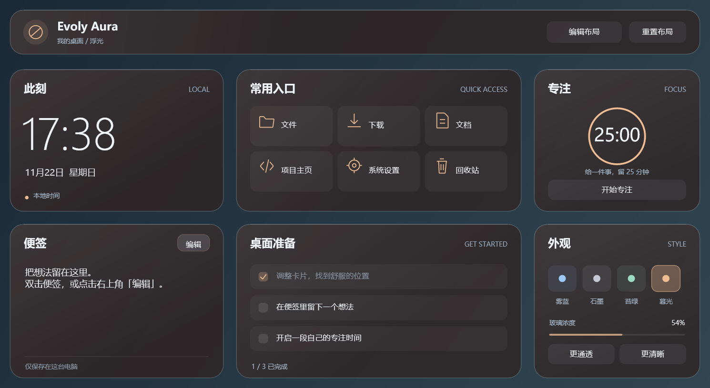
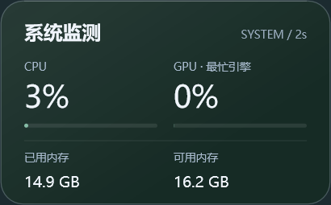

# Evoly Aura · 浮光桌面

面向 Windows 的低内存玻璃桌面空间：桌面陈列、悬浮 HUD、自由编排。

**当前阶段：原生桌面效果与交互框架已实现；先完善效果，再统一做性能验收。**

项目名称为 Evoly Aura，目录与远端仓库名称统一为 Evoly_Aura。
远端仓库：[Azl369/Evoly_Aura](https://github.com/Azl369/Evoly_Aura)（公开，已完成首次同步）。

截图来自实际原生窗口，间隙使用巡检用渐变背景，不修改 Windows 壁纸。

## 启动与唤起

双击 [Start-Aura.cmd](Start-Aura.cmd)，默认驻留桌面，不覆盖普通应用；缺少产物时先构建。
托盘单击或右键「唤起卡片」显示卡片，右键「隐藏卡片」或 Esc 收起。Ctrl+Alt+F10 切换显示/隐藏。
唤起后保持普通悬浮，其他应用可以覆盖；失去焦点不再自动回挂壁纸层。
普通悬浮不永久置顶；只有主动置顶的单卡与编辑布局时的卡片保持最前。
当前可操作：八块玻璃卡片、编辑/锁定、拖动/吸附/缩放、便签编辑与保存、
专注计时、四套强调色与玻璃浓度、唤起/隐藏、布局重启恢复。
新增右上角[系统监测卡片](docs/development/SYSTEM_MONITOR.md)：CPU、GPU、已用/可用内存，每两秒更新，隐藏时停止采样。

详细用法见 [桌面框架说明](docs/development/DESKTOP_WORKSPACE.md)，
阶段范围见 [效果框架计划](docs/plans/VISUAL_FRAMEWORK.md)。

## 产品方向

- 桌面态：文件夹、快捷方式和信息面板融入壁纸。
- 悬浮态：按需查看普通悬浮窗口，明确置顶的单卡才成为置顶 HUD。
- 编辑态：调整布局、尺寸和主题，完成后锁定布局。
- 低占用优先：原生常驻核心，按事件刷新，共享资源，有界缓存。

继承 Evoly 的交互经验、视觉语义与玻璃质感；当前选择 C++ / Win32 常驻架构。
Flutter 编辑器仅保留为未来备选，不属于当前依赖。

## 文档入口

1. [产品范围](docs/product/PRODUCT_BRIEF.md)
2. [工作区目录与职责](docs/development/WORKSPACE.md)
3. [架构设计](docs/architecture/ARCHITECTURE.md)
4. [原生架构决策 ADR](docs/architecture/adr/0001-native-resident-core.md)
5. [玻璃材质与渲染策略](docs/architecture/RENDERING.md)
6. [性能预算与测量协议](docs/performance/PERFORMANCE_BUDGET.md)
7. [分阶段开发计划](docs/plans/ROADMAP.md)
8. [首个性能原型计划](docs/plans/P0_NATIVE_PROBE.md)
9. [测试与验收](docs/testing/VALIDATION.md)
10. [Git / GitHub 工作流](docs/development/GIT_WORKFLOW.md)
11. [交付与远端状态](docs/development/DELIVERY_STATUS.md)
12. [原生构建、运行与测量](docs/development/NATIVE_BUILD.md)
13. [桌面框架使用与验证](docs/development/DESKTOP_WORKSPACE.md)

## 工作区概览

~~~text
Evoly_Aura/
  apps/host/                Aura 桌面入口与独立 P0 探针
  apps/editor/              按需编辑器（预留）
  src/                      布局、图像、Windows 窗口、玻璃渲染与本地存储
  include/aura/             P0 模块接口
  assets/                   图标、主题；不存大体积演示媒体
  config/examples/          可公开的配置格式草案
  docs/                     产品、设计决策、计划和验收
  tests/                    图像单元测试；集成与性能测试预留
  benchmarks/               测量协议与汇总，不存机器原始大文件
  tools/scripts/            工作区检查与后续开发工具
  cmake/                    后续构建辅助模块（预留）
  packaging/windows/        后续 Windows 发布配置（预留）
  .github/                  文档检查与协作模板
~~~

## 当前可执行检查

Windows PowerShell 5.1 或 PowerShell 7：

~~~powershell
powershell -NoProfile -File .\tools\scripts\Validate-Workspace.ps1
~~~

文档检查之外，可运行 tools/scripts/Build-Native.ps1 构建 Release 并执行 core 测试。
tools/scripts/Test-Workspace.ps1 验证实际桌面交互与重启恢复；
tools/scripts/Test-Probe.ps1 检查原有探针。此阶段不追加性能基准。

## 开发约定

- 项目源码在 F:\Evoly_Aura；新增 SDK、下载、包缓存和构建输出优先放 D:\dev。
- main 保存可复查的阶段成果；日常开发使用 codex/ 前缀分支。
- 不提交凭据、个人数据、本地路径配置、编译产物或性能原始转储。
- 尚未选定开源许可证。公开可见不等于已经授予开源许可；选定许可证后再正式发布。
