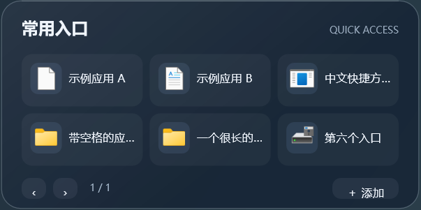

# 自定义常用入口

常用入口保留原来的六个默认项目，同时支持用户添加、删除、重命名和排序。
这是应用启动入口，不会扫描全部已安装应用，也不会为每个入口创建独立窗口或进程。

## 使用

- 点击卡片底部「添加」，选择一个或多个 `.exe`、`.lnk` 或 `.url`。
- 也可把这些文件拖到常用入口卡片，或使用 `Aura.exe --add-shortcut "绝对路径"`。
- 点击入口启动应用。`.lnk` 由 Windows 打开，保留原快捷方式中的参数和工作目录；直接添加的 `.exe` 使用所在目录。
- 右键入口可重命名、向前/向后移动、移除；移动可以跨页。
- 每页六项，底部箭头翻页，最多 256 项。长名称省略显示，保存完整名称。
- 移除只删除 Aura 内的记录，不删除原快捷方式、应用或用户文件。
- 右键「刷新图标」清除本工具的图标缓存，适用于应用图标变更之后。

原应用图标保持品牌颜色，统一尺寸、间距、圆角底板和当前主题强调色。
切换主题只重新绘制底板，不为四套主题分别复制位图；不依赖在线图标服务。
图标缺失或提取失败时显示同主题的通用轮廓图标，入口仍可启动。
第一版不是自动重绘所有品牌图标的单色图标包。

截图使用受控示例快捷方式和 Windows 系统图标，展示主题底板与长名称省略；不包含个人应用列表。

## 资源上限

| 资源 | 实现约束 |
| --- | --- |
| 可见项 | 一页最多六个，沿用原卡片表面 |
| 图标尺寸 | 根据 DPI 请求物理像素，16–128 px |
| CPU 位图 LRU | 最多 3 MiB、96 项，包括失败结果的缓存 |
| Direct2D 位图 | 最多六张；128 px 时约 0.375 MiB |
| 待提取队列 | 最多六项，一次一个任务，版本号丢弃过期结果 |
| 磁盘图标 | 最多 128 个文件、16 MiB，按最旧文件淘汰 |
| 配置 | 最多 256 项、1 MiB，UTF-8、原子替换 |

8 MiB 是图标像素及临时缓冲的保守设计预算，不是整个进程的增量承诺。
Shell、COM、系统文件选择器、字体与系统堆缓存需要单独测量，不能计入像素上限后声称免费。
隐藏时暂停任务并释放内存图标缓存和渲染位图；恢复时优先读磁盘缓存。
绘制线程只查内存缓存，文件读取和图标提取在 Windows 线程池执行。
仅为本地固定磁盘文件提取图标；网络路径、未提供本地图标的 `.url` 使用回退图标。
不调用第三方缩略图处理器、不下载网站 favicon、不预加载所有页面。

## 本地数据与验证

配置位于应用数据目录的 `launchers.txt`，图标位于同目录 `icon-cache/`。
默认数据目录为 `%LOCALAPPDATA%\EvolyAura`；这些个人入口、路径和图标不会上传 GitHub。
首次没有配置时生成默认六项；空列表保留为空。损坏配置保留原文件并回退到只读默认项目，避免覆盖。
重置桌面布局不会重置入口清单或便签。

`AuraLauncherTests` 验证持久化、中文、排序、空列表、限制、真实图标提取、缓存淘汰与清理。
`Test-CustomLaunchers.ps1` 使用私有测试目录和受控小程序，验证真实点击启动、重命名、跨页排序、
删除保留源文件、百项翻页、40 轮增删/主题切换、文件选择器取消和重启恢复，并记录进程计数器。
该脚本通过应用自身的导入消息测试导入路径；实际 Explorer 文件拖放和不同应用安装类型仍需兼容性验收。
本轮资源结果见 [增量测量](../performance/LAUNCHER_INCREMENT.md)，完整长稳验收继续保留在性能计划中。
